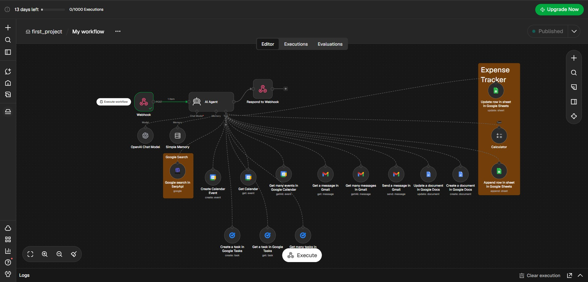
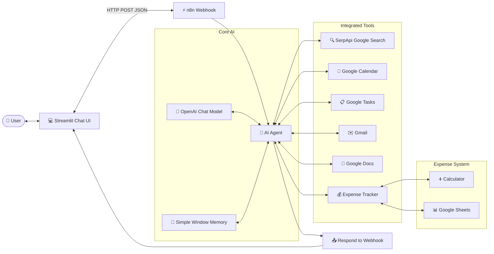

# 🤖 Autonomous Personal AI Assistant (n8n + Streamlit)

An autonomous multi-tool **Personal AI Assistant** powered by an **n8n Agentic Workflow** and an interactive **Streamlit** user interface. The assistant orchestrates multi-step tasks across real-world Google Workspace tools, real-time web search, and expense management using OpenAI LLM and conversational memory.

---

## 📸 Workflow & Application Preview

### 1. n8n Agentic Automation Workflow
The backbone of this assistant is built using n8n's AI Agent architecture with conversational memory and multi-tool orchestration:



### 2. Streamlit Web UI
Interactive web chat interface connecting seamlessly to the n8n webhook:


*(Streamlit run karke screenshot `screenshots/streamlit_ui.png` naam se save karein)*

---

## 🏗️ Architecture Overview



---

## ✨ Features & Integrated Tool Capabilities

As configured in the n8n agentic workflow:

| Tool Category | Node Name / Action | Capability |
| :--- | :--- | :--- |
| **🧠 Core LLM** | OpenAI Chat Model | High-reasoning chat model for tool selection and synthesis |
| **💾 Memory** | Simple Memory | Multi-turn conversational buffer memory for context retention |
| **🔍 Search** | Google Search in SerpApi | Real-time web browsing and information retrieval |
| **📅 Calendar** | Create, Get, & Get Many Events | Schedules, retrieves, and updates calendar meetings |
| **📋 Tasks** | Create, Get, & Get Many Tasks | Manages to-do lists and action items in Google Tasks |
| **✉️ Gmail** | Get Message, Get Many, Send Message | Reads, summarizes inbox emails and drafts/sends replies |
| **📄 Docs** | Create Document, Update Document | Takes meeting notes, drafts reports, and edits Google Docs |
| **💰 Expense Tracker**| Append Row, Update Row, Calculator | Performs calculations and logs financial records in Google Sheets |

---

## 📂 Project Structure

```text
n8n_workflow/
├── .streamlit/
│   ├── config.toml               # Streamlit theme & server settings
│   └── secrets.toml.example      # Sample secrets for Streamlit Cloud
├── screenshots/
│   ├── n8n_workflow.jpg          # n8n workflow canvas screenshot
│   └── streamlit_ui.png          # Streamlit UI screenshot placeholder
├── src/
│   └── n8n_workflow/
│       └── __init__.py
├── .env.example                  # Environment variable template
├── .gitignore                    # Git ignore file
├── .python-version               # Python version specification
├── app.py                        # Streamlit web chat application
├── main.py                       # Project entrypoint launcher
├── pyproject.toml                # Project packaging configuration
├── requirements.txt              # Production dependencies for Streamlit Cloud
├── testwebhook.py                # Standalone script to test webhook response
└── README.md                     # Project documentation
```

---

## 🚀 Getting Started (Local Development)

### Prerequisites
- Python 3.10+ installed
- [uv](https://github.com/astral-sh/uv) (recommended) or standard `pip`
- An active n8n instance (Self-hosted or n8n Cloud) with the workflow published

### 1. Clone the Repository
```bash
git clone <your-repo-url>
cd n8n_workflow
```

### 2. Install Dependencies
Using **uv**:
```bash
uv sync
```
Or using standard **pip**:
```bash
python -m venv .venv
# Windows:
.venv\Scripts\activate
# Linux/macOS:
# source .venv/bin/activate

pip install -r requirements.txt
```

### 3. Configure Webhook URL
Create a `.env` file from `.env.example`:
```bash
cp .env.example .env
```
Inside `.env`, set your n8n webhook URL:
```env
N8N_WEBHOOK_URL="https://your-instance.app.n8n.cloud/webhook/your-webhook-id"
```

> **Note on n8n Webhook URLs**:
> - **Testing Mode**: `https://<instance>/webhook-test/<id>` (requires clicking *"Test step"* or *"Listen for test event"* in n8n).
> - **Production Mode**: `https://<instance>/webhook/<id>` (requires publishing/activating the workflow by toggling **Published** to ON).

### 4. Test Webhook Connection
Run the standalone webhook test script:
```bash
uv run python testwebhook.py
# or
python testwebhook.py
```

### 5. Run the Streamlit Application
```bash
uv run streamlit run app.py
# or
streamlit run app.py
# or via main launcher
python main.py
```
Open your browser at `http://localhost:8501`.

---

## ☁️ Streamlit Cloud Deployment Guide

Follow these steps to deploy this project on **Streamlit Community Cloud** (free hosting):

### Step 1: Push Code to GitHub
Ensure all files are committed and pushed to your GitHub repository:
```bash
git add .
git commit -m "Complete n8n personal assistant with Streamlit UI"
git push origin main
```

### Step 2: Deploy on Streamlit Cloud
1. Go to [share.streamlit.io](https://share.streamlit.io/) and sign in with GitHub.
2. Click **"New app"**.
3. Select your repository: `username/n8n_workflow`.
4. Set **Branch**: `main`.
5. Set **Main file path**: `app.py`.

### Step 3: Configure Secrets in Streamlit Cloud
In the deployment settings, expand **"Advanced settings"** -> **"Secrets"**, and paste:
```toml
N8N_WEBHOOK_URL = "https://firstproject7208.app.n8n.cloud/webhook/783ce764-7ce6-4647-8de0-7c38ad0d4d21"
```
*(Make sure to use your **Production Webhook URL** without `-test` once the workflow is Published in n8n).*

### Step 4: Click Deploy!
Streamlit will install packages from `requirements.txt` and launch your assistant online with a public shareable URL.

---

## 💡 Usage Examples

Once connected, you can ask your personal assistant prompts such as:
- *"What meetings do I have scheduled for tomorrow?"*
- *"Add a task to Google Tasks: Complete Agentic AI assignment by Friday."*
- *"Check my latest unread emails in Gmail."*
- *"Add an expense of 450 INR for lunch in my expense sheet."*
- *"Create a Google Doc titled 'Meeting Notes' and add key discussion points."*
- *"Search the web for the latest updates on Quantum Computing in 2026."*

---

## 👨‍💻 Author
**Abhishek Pathak**  
- Email: `abhishek.pathak01111@gmail.com`
